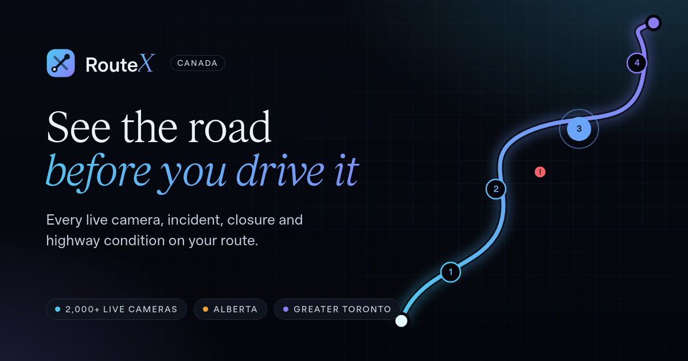

# RouteX

**See the road before you drive it.** RouteX puts every live traffic camera, incident, closure and highway condition on your drive in one place: across Alberta and the Greater Toronto Area so far, in driving order.

**Live:** https://routex-ca.pages.dev



## What it does

- **Plan a trip.** Set home, add destinations, and RouteX orders the stops for the shortest total distance. Round trip or one way.
- **Every camera on the way.** City of Calgary cameras, every 511 Alberta camera in the province, the City of Edmonton's live video cameras and the Town of Banff's street cameras within 250 m of the route, listed in the order you'll pass them. Scrolling the list moves along the route on the map.
- **Road conditions per camera.** Each picture shows the 511 Alberta winter road report for the highway it looks at (bare and dry, bare and wet, partly covered, covered, travel not recommended).
- **Incidents, closures and construction.** From the City of Calgary and 511 Alberta, filtered to your route, with a route-level Clear / Caution / Heavy summary.
- **Conditions along the route.** A strip showing each highway stretch's condition by kilometre, plus colour bands on the map.
- **Weather.** Forecast at home, each stop and along the way (Open-Meteo), plus 511 road weather stations.
- **Before I leave.** A full-screen, auto-advancing look at every camera on the route, one per screen.
- **Pick your city.** First-time visitors choose a city (Alberta or the Greater Toronto Area) from a searchable list or a drop-down; the map, search and data follow it.
- **Areas.** Five cameras spread evenly across your city (or one part of Calgary: NW, NE, Core, SW, SE), for a quick overview without a route.
- **Your own camera lists.** Pick cameras on a map, name the list, and play it back like an area. Lists stay in your browser.
- **Take it with you.** Save and favourite routes in the browser, open the whole trip in Google Maps with stops in order, download GPX, or share a link that rebuilds the trip.
- **Map.** Satellite or street basemap, Calgary community names, your live location, a Layers legend that doubles as filters, full screen, a swipe-up camera panel and pinch-to-zoom on pictures.

No account and no tracking: everything you save stays in your browser.

## How it works

| Part | What it uses |
| --- | --- |
| App | React 18, TypeScript, Vite, Leaflet, Motion, hls.js (Edmonton video, loaded on demand) |
| Hosting and API | Cloudflare Pages with Pages Functions (`functions/api`) as a caching proxy |
| Routing | OSRM public server: one distance table, then every stop order is tried (up to 8 stops) or nearest-neighbour plus 2-opt beyond that |
| Maps and search | Esri World Imagery and reference layers, ArcGIS World Geocoder |

The Pages Functions fetch and normalise the public feeds behind Cloudflare's edge cache, which keeps 511 Alberta within its 10-calls-a-minute limit and lets camera pictures refresh once a minute for everyone.

### Data sources

- **City of Calgary Open Data:** traffic cameras (`k7p9-kppz`), traffic incidents (`35ra-9556`), detours and closures (`w8zq-79bq`), community boundaries (`surr-xmvs`)
- **511 Alberta API:** cameras, events, winter road conditions, road weather stations and alerts, province-wide
- **City of Edmonton:** live HLS traffic video, listed by [edmontontrafficcam.com](https://edmontontrafficcam.com)
- **Town of Banff:** street camera pictures from [banff.ca](https://banff.ca/1065/Traffic-Cameras), placed on the map by hand
- **Greater Toronto Area:** [Ontario 511](https://511on.ca) highway cameras and events, [City of Toronto Open Data](https://open.toronto.ca/dataset/traffic-cameras/) cameras and road restrictions (Open Government Licence – Toronto), and [York Region](https://www.york.ca/transportation/roads/traffic-cameras) cameras
- **Open-Meteo:** weather forecast
- **OSRM:** driving routes and the distance table
- **Esri:** basemap imagery and geocoding

## Run it locally

You need Node 20+. A free developer key from [511 Alberta](https://511.alberta.ca) is recommended. Without one, the functions fall back to 511's public web feeds, which carry less detail: no road shapes or weather stations.

```bash
npm install
echo "AB511_KEY=your-key" > .dev.vars   # optional, kept out of git
npm run build
npx wrangler pages dev dist             # app and /api on http://localhost:8788
```

For live reloading, run `npm run dev` alongside `wrangler pages dev dist`; Vite proxies `/api` to port 8788.

### Fonts

RouteX is set in the Timeless type family (Timeless Grotesk, Timeless Sans and Timeless Serif). Its licence doesn't allow the font files in a public repository, so `public/fonts` isn't committed. The app falls back to system fonts without them. To build them:

1. Download Timeless free from [timeless.co](https://timeless.co).
2. `pip install fonttools brotli`
3. `scripts/fonts.sh /path/to/Timeless`

## Deploy

```bash
npx wrangler pages secret put AB511_KEY --project-name routex-ca
npm run deploy
```

## Project layout

```
functions/api/   Pages Functions: cameras, events, roads, frames (camera pictures), communities
shared/          Edge helpers: caching fetch, 511 client
src/components/  UI: map, planner, camera cards, Before I leave, Areas, alerts, weather
src/lib/         Routing and stop order, geometry, road condition grades, areas, storage
scripts/         Font build script
```

## Credits

Traffic camera images, video and data © City of Calgary, City of Edmonton, Town of Banff, 511 Alberta (Government of Alberta), Ontario 511 (Ministry of Transportation Ontario), City of Toronto and York Region, used under their open data terms. Weather by Open-Meteo. Routing by OSRM and OpenStreetMap contributors. Imagery © Esri, Maxar, Earthstar Geographics.
